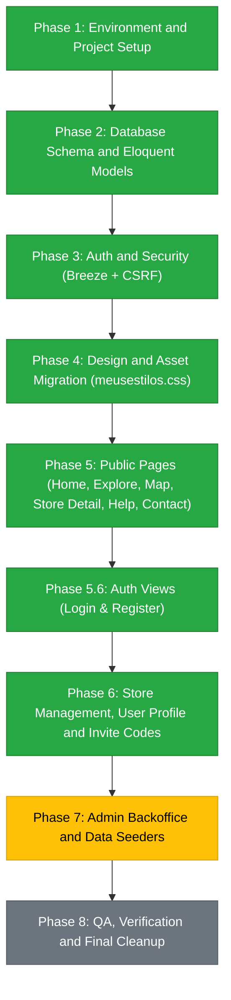

# Cá do Bairro - Laravel Migration Progress and Roadmap

Target: Modernize Cá do Bairro from procedural vanilla PHP to Laravel 11 with Blade, Bootstrap 5, built-in CSRF, and a normalized relational database.

---

## Status Summary

- Active Git Branch: `refactor/laravel-migration`
- Legacy Backup: All original files safely archived in `_legacy/`
- Rollback Safety: Run `git checkout main` at any time to return to the original working version.
- Framework Status: Laravel 11 installed, verified, and committed.

---

## Completed Milestones

### 1. Safety and Architecture Preparation
- [x] Initialized Git tracking and created migration branch `refactor/laravel-migration`.
- [x] Preserved legacy application files by moving them into `_legacy/` (including all `components/`, `scripts/`, `css/`, `js/`, and database connections).
- [x] Enabled PHP `zip` extension in Laragon (`php.ini`) to allow fast dependency downloads.

### 2. Laravel 11 Skeleton Setup
- [x] Created clean Laravel 11 application structure in project root.
- [x] Installed Composer dependencies with locked versions.
- [x] Generated application encryption key (`php artisan key:generate`).
- [x] Verified CLI and artisan availability (`Laravel Framework 13.x`).
- [x] Committed initial Laravel baseline into Git.

---

## Migration Roadmap and Next Steps

---

## Detailed Task Checklist

### Phase 2: Database Schema and Eloquent Models (Completed)
- [x] Configure `.env` for local MySQL (`DB_DATABASE=sam_laravel`).
- [x] Create `stores` table migration (`name`, `description`, `place_id`, `lat`, `lon`, `logo_path`).
- [x] Create `store_user` pivot migration (`store_id`, `user_id`, `role: owner|employee`).
- [x] Create `categories` and `services` migrations (including `service_store` pivot).
- [x] Create `store_invite_codes` migration (`store_id`, `code`, `expires_at`, `used_by`, `used_at`).
- [x] Define Eloquent Models with relationships:
  - `User`: `stores()`, `ownedStores()`, `employedStores()`
  - `Store`: `users()`, `owners()`, `employees()`, `services()`, `inviteCodes()`
  - `Category`: `services()`
  - `Service`: `category()`, `stores()`
  - `StoreInviteCode`: `store()`, `user()`, `isValid()`
- [x] Verified with automated feature tests (`StoreModelTest` - 3 tests, 12 assertions passing).

### Phase 3: Auth and Security (Breeze + CSRF) (Completed)
- [x] Install Laravel Breeze (Blade stack) for battle-tested auth.
- [x] Configure authentication routes (login, register, password reset, profile).
- [x] Unify customer and employee authentication into the single `User` model with role checks.
- [x] Verify CSRF protection across all forms (`@csrf`).
- [x] Build front-end assets with Vite (`public/build`).
- [x] Verified full auth test suite (28 tests, 73 assertions passing).

### Phase 4: Design and Asset Migration (Completed)
- [x] Copy `_legacy/css/meusestilos.css` to `public/css/meusestilos.css`.
- [x] Copy `_legacy/js/scripts.js` to `public/js/scripts.js` and icons to `public/images/` and `public/favicon.ico`.
- [x] Set up master Blade layout (`resources/views/layouts/market.blade.php`).
- [x] Port `cp_navbar.php` and `cp_footer.php` into reusable Blade components (`<x-navbar>`, `<x-footer>`).
- [x] Verify that Google Fonts and market/carimbo design tokens (`--ink`, `--paper`, `--ochre`) render identically.
- [x] Created `home.blade.php` testing `<x-market-layout>` with 100% passing tests.

### Phase 5: Public Pages (In Progress)
- [x] **Home Page (`/`)**: Port `_legacy/components/cp_index_intro.php` to `home.blade.php` and `HomeController@index`.
- [x] **Search Auto-complete**: Wire client-side store search to Eloquent/JSON API (`/api/stores/search` in `HomeController@search`).
- [x] **Component Modernization & Design Polish**:
  - Navbar (`resources/views/components/navbar.blade.php`): Deep ink theme (`--ink`), ochre bottom border (`--ochre`), centered navigation links (`Início`, `Lojas`, `Mapa`, `Ajuda`), brand logo (`Cá do Bairro`), and pill action buttons.
  - Footer (`resources/views/components/footer.blade.php`): Modernized 3-column layout matching the market design system.
  - Merchant CTA Card: Cleaned and unified the "Não espere mais" section into `.merchant-cta-card`.
  - CSS Cleanup: Removed dead prototype rules, removed global `nav !important` and `.sam !important` locks, and enabled automatic CSS cache-busting.
- [x] **Automated Tests**: Added `tests/Feature/HomeControllerTest.php` (all 31 test suite assertions passing).
- [x] **Explore / Lojas Page (`/explorar`)**: Ported `_legacy/components/cp_explorar.php` to `ExploreController@index` and `resources/views/explore.blade.php`. Supports category filter chips, search query by store name/description, responsive store cards, empty states, and pagination.
- [x] **Interactive Map (`/mapa`)**: Ported `_legacy/components/cp_map.php` into `MapController@index` and `resources/views/map.blade.php`. Uses Google Maps JS API with `AdvancedMarkerElement`, marker clustering, custom market pin badges, rich InfoWindows, and automatic bounds fitting.
- [x] **Store Detail (`/lojas/{id}`)**: Ported `_legacy/components/cp_loja.php` to `StoreController@show` and `resources/views/stores/show.blade.php`. Features store hero card, product/service catalog grouped by category, interactive location mini-map with Google Maps JS API, and native link sharing.
- [x] **FAQ and Info (`/ajuda`, `/contacto`)**: Ported static content to `InfoController`, `resources/views/help.blade.php`, and `resources/views/contact.blade.php` featuring responsive market accordion, direct contact channels, validated contact form, and 100% passing feature tests.

  ### Phase 5.6: Auth Views Migration (Login & Register) (Completed)
- [x] **Login Screen (`/login`)**: Ported `_legacy/components/cp_login.php` into `resources/views/auth/login.blade.php` using `<x-market-layout>`, `.auth-card` with pure white contrast, brand typography, password toggle, unified login banner, and verified via automated tests.
- [x] **Registration Screen (`/register`)**: Ported `_legacy/components/cp_registo.php` into `resources/views/auth/register.blade.php` with Portuguese labels, pure white high-contrast card, double password visibility toggles, localized Portuguese validation dictionary, and verified via automated tests.

### Phase 6: Store Management and User Profile
- [x] **Store Registration (`/lojas/registar`)**: 2-step wizard using Google Places API without user deletion, attaching user as owner in `store_user`, and verified via automated tests.
- [x] **Profile Page Migration (`/profile`)**: Ported `_legacy/components/cp_perfil.php` to `resources/views/profile/edit.blade.php` using `<x-market-layout>`, avatar initials, user information management, password change with visibility toggles, store affiliations overview (owned and employed stores), and verified via automated tests.
- [x] **Store Dashboard (`/gestao/lojas`)**: Ported `_legacy/components/cp_info_lojas.php` to `StoreManagementController@index` and `resources/views/management/stores/index.blade.php` with merchant KPI stats, responsive store cards, role badges (Owner vs Employee), and verified via automated tests.
- [x] **Single Store Management (`/gestao/lojas/{id}`)**: Ported `_legacy/components/cp_gerir_loja.php` to `StoreManagementController@edit/update` and `resources/views/management/stores/edit.blade.php`, allowing owners to edit store details, manage the employee roster, and remove staff safely.
- [x] **Invite Code Generation**: AJAX/POST route (`POST /gestao/lojas/{store}/convites`) generating unique 7-character alphanumeric codes with 7-day expiration, active codes modal, and one-click clipboard copying.
- [x] **Join Store Modal**: Secure POST route (`POST /lojas/juntar`) validating 7-character invite codes and attaching users as employees to the `store_user` pivot table without account overwrite.

### Phase 7: Admin Backoffice (Completed)
- [x] **Admin Middleware (`admin`)**: Created `EnsureUserIsAdmin` middleware registered in `bootstrap/app.php`, validating `$user->isAdmin()` (`is_admin` boolean column on `users` table) and aborting with HTTP 403 Forbidden for unauthorized users.
- [x] **Admin Dashboard Controller (`AdminDashboardController@index`)**: Aggregates platform KPIs (total users, registered stores, active categories, total services), recent user registrations, category service distributions, and latest stores.
- [x] **Admin Dashboard View (`resources/views/admin/dashboard.blade.php`)**: Fully ported `_legacy/administracao/` (`index.php`, `cp_index_admin.php`, `cp_navbar_admin.php`) using `<x-market-layout>`, Market Design System KPI cards, responsive data tables with badges and empty states, category progress bars, and admin navbar shortcut link.
- [x] **Automated Tests**: Added `tests/Feature/AdminDashboardTest.php` covering guest redirects, non-admin forbidden status, store-owner-only forbidden status, admin metrics visibility, and dynamic navbar administration links (all 5 tests passing; full test suite at 81 tests).
- [x] **Legacy Data Importer**: Intentionally omitted per explicit project requirement.

### Phase 8: QA and Final Cleanup (Completed)
- [x] **Custom Error Handlers & Pages**: Implemented brand-consistent error views for `403` (Forbidden), `404` (Not Found), and `500` (Server Error) in `resources/views/errors/` with Market Design System cards, responsive badges, and direct navigation links.
- [x] **Automated Error Page Verification**: Added `tests/Feature/ErrorPagesTest.php` verifying HTTP 404, HTTP 403, and HTTP 500 rendering and UI controls (all 84 test suite tests passing with 305 assertions).
- [x] **Legacy SQL Archival**: Safely copied `_legacy/sam_backup.sql` to `database/legacy_sam_backup.sql` to guarantee historical data preservation.
- [x] **Archive & Remove `_legacy/` folder**: Entire legacy codebase preserved on branch `archive/legacy` and tag `v0.9-legacy`, and local `_legacy/` directory removed.
- [x] **Merge `refactor/laravel-migration` into `main`**: All 8 migration phases successfully completed, merged into `main`, and fully verified.

---

## Reference Mapping (Legacy File -> New Laravel Destination)

| Legacy File (`_legacy/`) | Target Laravel Destination | Responsibility |
|---|---|---|
| `connections/connection.php` | `config/database.php` and `.env` | Database connection via PDO/Eloquent |
| `components/cp_head.php` | `resources/views/layouts/app.blade.php` | HTML `<head>`, styles, fonts |
| `components/cp_navbar.php` | `resources/views/components/navbar.blade.php` | Navigation bar with auth checks and admin entry |
| `components/cp_footer.php` | `resources/views/components/footer.blade.php` | Page footer and script includes |
| `components/cp_index_intro.php` | `resources/views/home.blade.php` | Landing page, hero, live search |
| `components/cp_loja.php` | `resources/views/stores/show.blade.php` | Public store profile |
| `components/cp_perfil.php` | `resources/views/profile/edit.blade.php` | User profile, credentials, and store affiliations |
| `components/cp_registo_lojas.php` | `resources/views/stores/create.blade.php` | Store registration wizard |
| `components/cp_info_lojas.php` | `resources/views/management/stores/index.blade.php` | Employee store list |
| `components/cp_gerir_loja.php` | `resources/views/management/stores/edit.blade.php` | Store editor and employee management |
| `administracao/index.php` | `AdminDashboardController@index` | Entry point for administrative backoffice |
| `administracao/cp_index_admin.php` | `resources/views/admin/dashboard.blade.php` | Admin metrics, platform statistics, and tables |
| `administracao/cp_navbar_admin.php` | `resources/views/components/navbar.blade.php` | Unified navbar with role-based admin entry |
| `scripts/sc_registo_lojas.php` | `StoreRegistrationController@store` | Backend store creation logic |
| `scripts/sc_join.php` | `StoreInviteController@join` | Attach user to store via invite code |
| `scripts/sc_login.php` | Laravel Breeze `AuthenticatedSessionController` | Secure session authentication |
| `scripts/sc_registo.php` | Laravel Breeze `RegisteredUserController` | Account registration |

---

## Developer Notes & Key Conventions

For full design specifications and development guidelines, consult [README.md](file:///c:/laragon/www/pessoal/README.md#developer-notes--implementation-rules). Key reminders:
1. **Avatar Initials**: Strip `[MOCK]` tags and Portuguese stopwords (`de`, `da`, `do`, `dos`, `das`, `e`, `&`) so store names yield authentic 2-letter initials (e.g. `Padaria do Bairro` &rarr; `PB`, not `[P`).
2. **Google Maps JS API**: Declare explicit inline heights on map containers (`style="height: 260px; min-height: 260px;"`) to prevent collapse, and use `AdvancedMarkerElement` with custom market pins (`<i class="fa-solid fa-store"></i>`).
3. **No Fake Verification**: There is no store verification status in this app; never generate placeholder verification badges.
4. **Backlog Tracking**: Street addresses (`morada`) and opening hours (`horario_atendimento`) are tracked in `README.md#planned-features--backlog` for Phase 6.
5. **Git Safety**: Always summarize proposed changes and request explicit user approval before committing or pushing.

