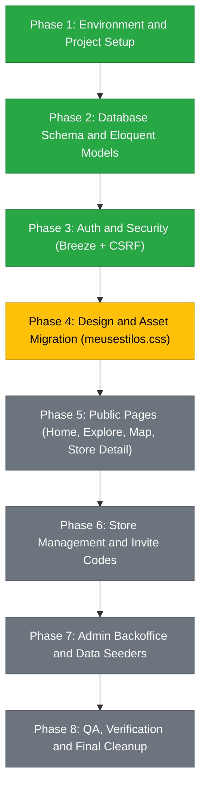

# S.A.M - Laravel Migration Progress and Roadmap

Target: Modernize S.A.M from procedural vanilla PHP to Laravel 11 with Blade, Bootstrap 5, built-in CSRF, and a normalized relational database.

---

## Status Summary

- Active Git Branch: `refactor/laravel-migration`
- Legacy Backup: All original files safely archived in `_legacy/`
- Rollback Safety: Run `git checkout main` at any time to return to the original working version.
- Framework Status: Laravel 11 installed, verified, and committed.

---

## Completed Milestones

### 1. Safety and Architecture Preparation
- [x] Initialized Git tracking and created migration branch `refactor/laravel-migration`.
- [x] Preserved legacy application files by moving them into `_legacy/` (including all `components/`, `scripts/`, `css/`, `js/`, and database connections).
- [x] Enabled PHP `zip` extension in Laragon (`php.ini`) to allow fast dependency downloads.

### 2. Laravel 11 Skeleton Setup
- [x] Created clean Laravel 11 application structure in project root.
- [x] Installed Composer dependencies with locked versions.
- [x] Generated application encryption key (`php artisan key:generate`).
- [x] Verified CLI and artisan availability (`Laravel Framework 13.x`).
- [x] Committed initial Laravel baseline into Git.

---

## Migration Roadmap and Next Steps

---

## Detailed Task Checklist

### Phase 2: Database Schema and Eloquent Models (Completed)
- [x] Configure `.env` for local MySQL (`DB_DATABASE=sam_laravel`).
- [x] Create `stores` table migration (`name`, `description`, `place_id`, `lat`, `lon`, `logo_path`).
- [x] Create `store_user` pivot migration (`store_id`, `user_id`, `role: owner|employee`).
- [x] Create `categories` and `services` migrations (including `service_store` pivot).
- [x] Create `store_invite_codes` migration (`store_id`, `code`, `expires_at`, `used_by`, `used_at`).
- [x] Define Eloquent Models with relationships:
  - `User`: `stores()`, `ownedStores()`, `employedStores()`
  - `Store`: `users()`, `owners()`, `employees()`, `services()`, `inviteCodes()`
  - `Category`: `services()`
  - `Service`: `category()`, `stores()`
  - `StoreInviteCode`: `store()`, `user()`, `isValid()`
- [x] Verified with automated feature tests (`StoreModelTest` - 3 tests, 12 assertions passing).

### Phase 3: Auth and Security (Breeze + CSRF) (Completed)
- [x] Install Laravel Breeze (Blade stack) for battle-tested auth.
- [x] Configure authentication routes (login, register, password reset, profile).
- [x] Unify customer and employee authentication into the single `User` model with role checks.
- [x] Verify CSRF protection across all forms (`@csrf`).
- [x] Build front-end assets with Vite (`public/build`).
- [x] Verified full auth test suite (28 tests, 73 assertions passing).

### Phase 4: Design and Asset Migration
- [ ] Copy `_legacy/css/meusestilos.css` to `public/css/meusestilos.css`.
- [ ] Set up master Blade layout (`resources/views/layouts/app.blade.php`).
- [ ] Port `cp_navbar.php` and `cp_footer.php` into reusable Blade components (`<x-navbar>`, `<x-footer>`).
- [ ] Verify that Google Fonts and market/carimbo design tokens (`--ink`, `--paper`, `--ochre`) render identically.

### Phase 5: Public Pages
- [ ] **Home Page (`/`)**: Port `_legacy/components/cp_index_intro.php` to `home.blade.php`.
- [ ] **Search Auto-complete**: Wire client-side store search to Eloquent/JSON API.
- [ ] **Explore Page (`/explorar`)**: Group services by category in Blade.
- [ ] **Interactive Map (`/mapa`)**: Port `_legacy/components/cp_map.php` to Google Maps JS Blade view.
- [ ] **Store Detail (`/lojas/{id}`)**: Display store header, location map embed, and catalog.
- [ ] **FAQ and Info (`/ajuda`, `/contacto`)**: Port static content to lightweight controller/views.

### Phase 6: Store Management and Invite Codes
- [ ] **Store Registration (`/lojas/registar`)**: 2-step wizard using Google Places API without user deletion.
- [ ] **Store Dashboard (`/gestao/lojas`)**: List managed stores for authenticated employees.
- [ ] **Single Store Management (`/gestao/lojas/{id}`)**: Update store info and manage employee table.
- [ ] **Invite Code Generation**: AJAX/POST route generating 7-character expiring codes.
- [ ] **Join Store Modal**: Secure POST route validating invite code and attaching user to `store_user` pivot table.

### Phase 7: Admin Backoffice and Data Migration
- [ ] Port `_legacy/administracao/` into `app/Http/Controllers/Admin/`.
- [ ] Restrict admin access via `role:admin` middleware.
- [ ] Create legacy data importer script to copy old records from `sam` into `sam_laravel`.

### Phase 8: QA and Final Cleanup
- [ ] Verify all routes, error handlers, and validation rules.
- [ ] Remove `_legacy/` folder once all features are successfully ported.
- [ ] Merge `refactor/laravel-migration` into `main`.

---

## Reference Mapping (Legacy File -> New Laravel Destination)

| Legacy File (`_legacy/`) | Target Laravel Destination | Responsibility |
|---|---|---|
| `connections/connection.php` | `config/database.php` and `.env` | Database connection via PDO/Eloquent |
| `components/cp_head.php` | `resources/views/layouts/app.blade.php` | HTML `<head>`, styles, fonts |
| `components/cp_navbar.php` | `resources/views/components/navbar.blade.php` | Navigation bar with auth checks |
| `components/cp_footer.php` | `resources/views/components/footer.blade.php` | Page footer and script includes |
| `components/cp_index_intro.php` | `resources/views/home.blade.php` | Landing page, hero, live search |
| `components/cp_loja.php` | `resources/views/stores/show.blade.php` | Public store profile |
| `components/cp_registo_lojas.php` | `resources/views/stores/create.blade.php` | Store registration wizard |
| `components/cp_info_lojas.php` | `resources/views/management/stores/index.blade.php` | Employee store list |
| `components/cp_gerir_loja.php` | `resources/views/management/stores/edit.blade.php` | Store editor and employee management |
| `scripts/sc_registo_lojas.php` | `StoreRegistrationController@store` | Backend store creation logic |
| `scripts/sc_join.php` | `StoreInviteController@join` | Attach user to store via invite code |
| `scripts/sc_login.php` | Laravel Breeze `AuthenticatedSessionController` | Secure session authentication |
| `scripts/sc_registo.php` | Laravel Breeze `RegisteredUserController` | Account registration |

